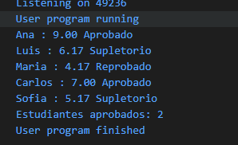
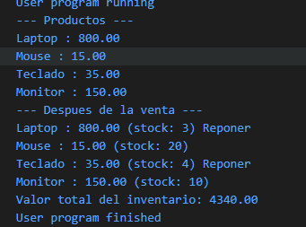
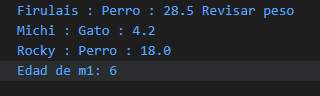
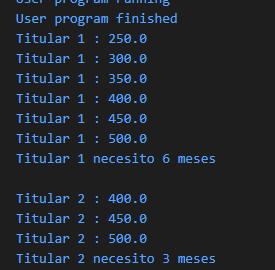
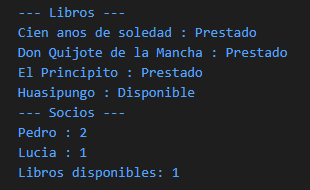

# Guía APE · Introducción a la Programación Orientada a Objetos (Java)

Repositorio con la resolución de los cinco ejercicios de la **Guía APE**, desarrollados en Java aplicando los conceptos vistos en las tres sesiones de la asignatura: clases, atributos, constructores, instancias, arreglos, condicionales, ciclos y referencias a objetos.

> **Autor:** Matias Pico
> **Asignatura:** ALGORITMOS Y LOGICA DE PROGRAMACION
> **Docente:** Rubén Caiza

---

## Contenido

| # | Ejercicio | Archivo | Clases | Conceptos |
|---|-----------|---------|--------|-----------|
| 1 | [Notas del curso](#1-notas-del-curso) | `Ejercicio1.java` | `Estudiante` | Clases, arreglos, `if / else if`, contador |
| 2 | [Inventario de una tienda](#2-inventario-de-una-tienda) | `Ejercicio2.java` | `Producto` | Modificar atributos, acumulador, condicional |
| 3 | [Veterinaria](#3-veterinaria) | `Ejercicio3.java` | `Mascota` | Referencias a objetos (aliasing) |
| 4 | [Cuenta de ahorro](#4-cuenta-de-ahorro) | `Ejercicio4.java` | `Cuenta` | Ciclo `while` |
| 5 | [Biblioteca](#5-biblioteca) | `Ejercicio5.java` | `Libro`, `Socio` | Varias clases, `boolean`, contadores |

## Estructura del proyecto

```
.
├── Ejercicio1.java
├── Ejercicio2.java
├── Ejercicio3.java
├── Ejercicio4.java
├── Ejercicio5.java
├── images/
│   ├── ejercicio1.png
│   ├── ejercicio2.png
│   ├── ejercicio3.png
│   ├── ejercicio4.png
│   └── ejercicio5.png
└── README.md
```

Cada archivo `.java` es independiente: contiene la clase principal con el método `main` y las clases auxiliares que necesita el ejercicio.

## Requisitos

- **JDK 11 o superior** (se probó con JDK 21).
- Una terminal o un IDE (IntelliJ IDEA, NetBeans, Eclipse, VS Code).

Para comprobar la instalación:

```bash
java -version
```

## Cómo ejecutar

**Opción 1 · Ejecutar el archivo directamente** (JDK 11 o superior):

```bash
java Ejercicio1.java
```

**Opción 2 · Compilar y luego ejecutar:**

```bash
javac Ejercicio1.java
java Ejercicio1
```

Se cambia el número del archivo para ejecutar cada ejercicio (`Ejercicio2`, `Ejercicio3`, etc.).

---

## 1. Notas del curso

**Enunciado:** crear la clase `Estudiante` con los atributos `nombre`, `nota1`, `nota2`, `nota3` y `promedio`. En `main`, crear 5 instancias, calcular el promedio de cada una e imprimirlas con el formato `nombre : promedio`, agregando **Aprobado** (7 o más), **Supletorio** (de 5 a 6.99) o **Reprobado** (menos de 5). Al final, imprimir cuántos estudiantes aprobaron.

**Solución:** un método `calcularPromedio()` en la clase `Estudiante` obtiene el promedio de las tres notas. Un arreglo de cinco estudiantes se recorre con un `for`, y una estructura `if / else if / else` determina el estado de cada uno mientras un contador suma los aprobados.

**Ejecución:**



---

## 2. Inventario de una tienda

**Enunciado:** crear la clase `Producto` con `nombre`, `precio` y `stock`. Crear 4 productos e imprimirlos con el formato `nombre : precio`. Simular la venta de 3 unidades de dos de ellos, mostrar **Reponer** junto a cada producto que quede con menos de 5 unidades e imprimir el valor total del inventario (suma de precio por stock).

**Solución:** se venden 3 unidades de la Laptop (stock 6 → 3) y del Teclado (stock 7 → 4). Al recorrer de nuevo el arreglo se muestra "Reponer" cuando `stock < 5`, y un acumulador suma `precio * stock` de todos los productos.

**Ejecución:**



---

## 3. Veterinaria

**Enunciado:** crear la clase `Mascota` con `nombre`, `especie`, `edad` y `peso`. Crear 3 mascotas e imprimirlas con el formato `nombre : especie : peso`, mostrando **Revisar peso** si pesan más de 20 kg. Luego escribir `Mascota m4 = m1;`, sumar 1 a `m4.edad`, imprimir `m1.edad` y explicar en un comentario por qué cambió.

**Solución:** solo Firulais (28.5 kg) supera los 20 kg, por lo que es el único con el aviso.

**¿Por qué cambió `m1.edad`?** `Mascota` es una clase, es decir, un tipo por referencia. La instrucción `Mascota m4 = m1;` no crea un objeto nuevo: copia la referencia (la dirección en memoria). Así, `m1` y `m4` apuntan al **mismo objeto**, y al modificar `m4.edad` se modifica el único objeto que ambas variables comparten. Por eso `m1.edad` pasa de 5 a 6.

**Ejecución:**



---

## 4. Cuenta de ahorro

**Enunciado:** crear la clase `Cuenta` con `titular` y `saldo`. Crear 2 cuentas, una con 200 y otra con 350. Con un `while`, depositar 50 por mes en cada cuenta hasta que llegue a 500, imprimiendo cada mes con el formato `titular : saldo`, y al final cuántos meses necesitó cada una (6 y 3).

**Solución:** un ciclo `while (c.saldo < 500)` suma 50 al saldo y aumenta un contador de meses en cada vuelta. La primera cuenta necesita 6 meses (200 → 500) y la segunda 3 meses (350 → 500).

**Ejecución:**



---

## 5. Biblioteca

**Enunciado:** crear las clases `Libro` (`titulo`, `autor`, `disponible`) y `Socio` (`nombre`, `librosPrestados`). Crear 4 libros y 2 socios, registrar que el primer socio presta 2 libros y el segundo presta 1 (`disponible = false` y aumentar `librosPrestados`), y al final imprimir cada libro con el formato `titulo : Disponible` o `titulo : Prestado`, cada socio con el formato `nombre : librosPrestados` y cuántos libros quedan disponibles.

**Solución:** al registrar un préstamo se cambia `disponible` a `false` en el libro y se incrementa `librosPrestados` en el socio. Luego se recorren los arreglos para imprimir el estado de cada libro, los préstamos de cada socio y el total de libros que siguen disponibles (1 de 4).

**Ejecución:**



---

